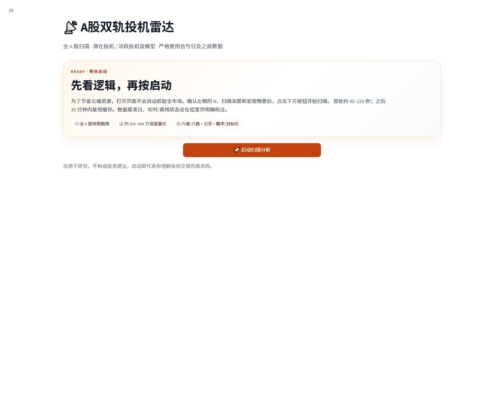
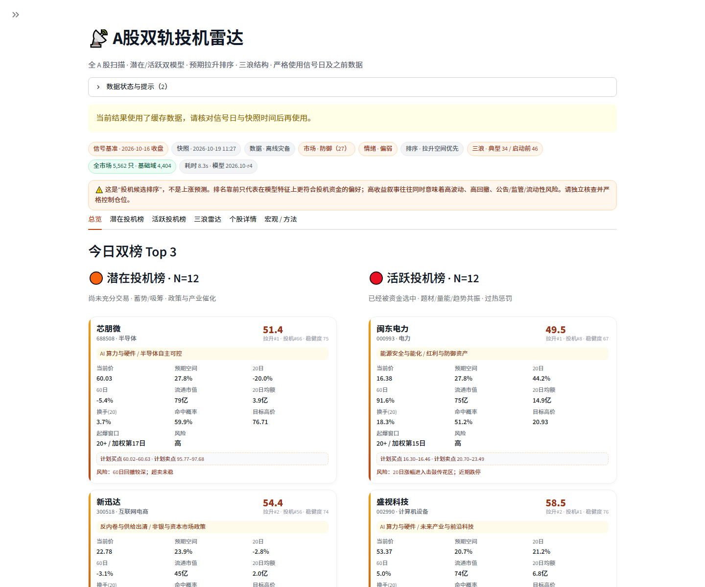
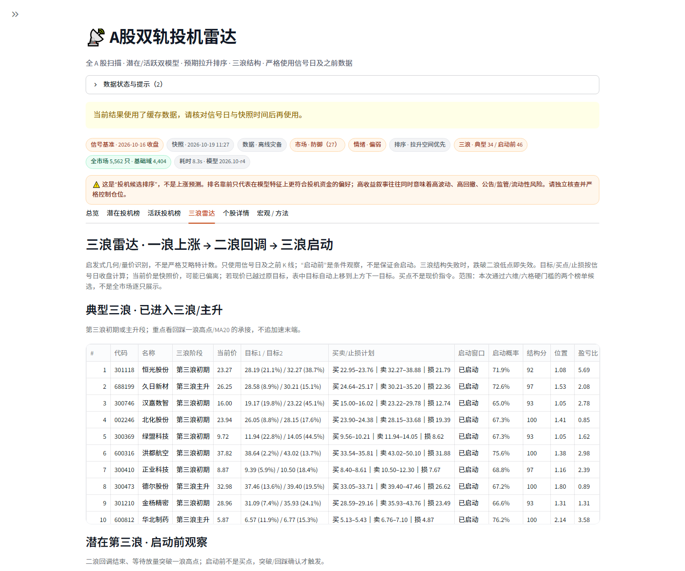
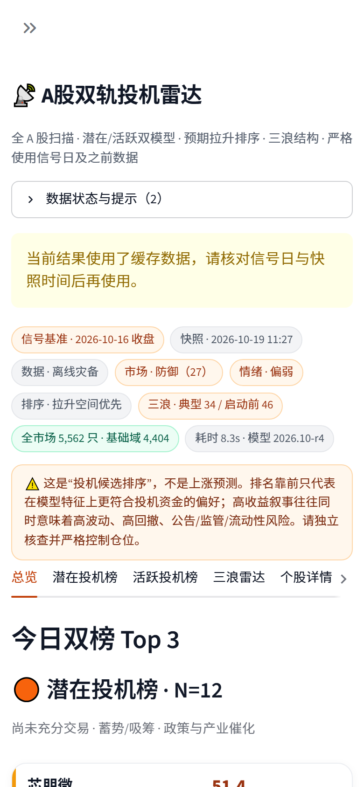
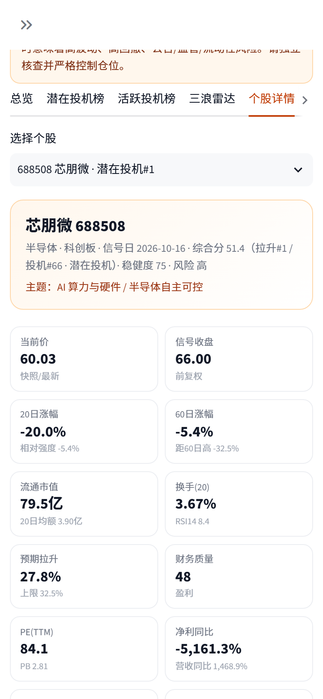

# A股双轨投机雷达 · SpecRadar

全 A 股扫描，用两套**严格区分**的特征体系分别回答，并增加“预期拉升空间”排序、交易计划与“三浪雷达”：

1. **最有潜在投机价值**：还没被市场充分交易、处于蓄势/低位，但具备政策与产业催化、筹码沉淀和资金潜伏特征的股票；
2. **最有投机价值**：已经被资金选中，处于题材、量能、趋势与资金流共振阶段，具备短线博弈/接力价值，同时惩罚追高过热的股票。**这不是“最值得长期持有”**，而是“几天到几周内能否被资金继续炒作”的排序。

两个榜单默认按**预期拉升空间**降序排列，也可在侧栏切换为“预期拉升上限优先”“财务质量优先”或“投机综合分”；N 可在界面手动选择（3–50 只；通过六维/六格硬门槛后可能少于 N）。另外新增“三浪雷达”页，分别展示典型三浪与第三浪启动前候选。支持桌面与手机浏览器，支持本地运行、GitHub + Streamlit Community Cloud 部署。

> ⚠️ **这不是上涨预测，也不构成任何投资建议。** 排名靠前只代表在模型特征上更符合“投机资金偏好”。投机意味着高波动、高回撤、公告/监管/流动性风险；任何模型都可能失效。请独立核查并严格控制仓位。

## 界面预览

> 以下截图来自**离线灾备演示模式**（`SPEC_RADAR_OFFLINE=1`），所以顶部显示缓存提示；正常联网运行时数据基准日与快照时间会随交易日更新。打开页面先停在启动页，点击“启动扫描分析”才开始抓取。







<p align="center">
  
  &nbsp;&nbsp;
  
</p>

---

## 1. 快速开始（本地）

要求 Python 3.11–3.13（推荐 3.12）。

```bash
cd ashare-spec-radar
python -m venv .venv
# Windows
.venv\Scripts\activate
# macOS / Linux
# source .venv/bin/activate

pip install -r requirements.txt
streamlit run app.py
```

浏览器打开 <http://localhost:8501>。Windows 也可以直接双击 `启动网页版.bat`。

**页面不会自动扫描**：打开后先显示启动页，确认 N/扫描深度/宏观情景后，点击 **🚀 启动扫描分析** 才会抓取行情。这是为了节省云端资源，也避免你一打开就触发一次长请求。

命令行版本（不启动网页）：

```bash
python scripts/scan.py --n 12 --depth 300
# 查看帮助
python scripts/scan.py --help
```

首次实时扫描需要抓取全市场快照与候选股日 K，通常 40–120 秒；之后会复用缓存。手机与电脑访问同一个 Streamlit URL 即可，页面已做移动端适配。

### 离线/无网络演示

仓库内含最近一次成功数据的灾备包 `data/bootstrap/`。接口不可用时程序会自动使用它，并在页面顶部显著标注数据基准日，**不会把旧数据伪装成实时数据**。

强制离线模式（适合本地演示、云端接口故障时临时打开）：

```bash
# Windows PowerShell
$env:SPEC_RADAR_OFFLINE="1"
streamlit run app.py
```

```bash
# macOS / Linux
SPEC_RADAR_OFFLINE=1 streamlit run app.py
```

---

## 2. 部署到 GitHub + Streamlit Cloud（手机可访问）

完整步骤见 [DEPLOY_STREAMLIT.md](DEPLOY_STREAMLIT.md)。最短路径：

1. 新建 GitHub 仓库，把本目录所有文件推上去；
2. 打开 <https://share.streamlit.io> → **New app**；
3. 选择仓库 / 分支，Main file path 填 `app.py`；
4. Python version 选 3.12；
5. Deploy。部署完成后用手机打开生成的 `https://<app>.streamlit.app`。

Streamlit Cloud 首次启动会执行 `pip install -r requirements.txt`。**注意：Streamlit 只读取仓库根目录的 `requirements.txt`。** 如果你把整个 `ashare-spec-radar/` 文件夹放进一个更大的 GitHub 仓库，请要么把本目录内容移到仓库根目录、Main file 填 `app.py`；要么保留子目录，但在仓库根目录再放一份 `requirements.txt`，Main file 填 `ashare-spec-radar/app.py`。当前图表使用 Streamlit 自带依赖 Altair，不再强依赖 Plotly；但根目录依赖文件仍是部署规范。

如果云端访问中国行情接口不稳定，程序会自动降级到内置灾备包并提示；也可以先在本地运行一次 `python scripts/build_bootstrap.py`，提交更新后的 `data/bootstrap/` 再部署。

**不需要 API Key，不需要数据库。** 数据来自公开行情接口。

---

## 3. 两套模型到底在筛什么

### 3.1 潜在投机价值（潜伏/蓄势）

定义：尚未被市场充分交易，处在蓄势或相对低位，但政策/产业催化、筹码沉淀与资金潜伏特征明显的股票。

硬性门槛（配置于 `config/model.json`）：

- 非 ST、非退市整理、非北交所、非停牌；
- 上市 ≥ 400 天，至少有 170 根日 K（避免次新股与历史过短）；
- 流通市值 12–900 亿元；20 日均成交额 ≥ 0.45 亿元；
- 60 日涨幅 ≤ 60%、20 日涨幅 ≤ 32%、20 日平均换手 ≤ 14%、20 日涨停次数 ≤ 2；
- 不满足这些条件的股票即使“故事很好”也不会进入潜在榜。

八个分项（权重合计 100%）：

| 分项 | 权重 | 核心特征 |
|---|---:|---|
| 赛道政策催化 | 20% | 行业/概念与当前政策主线、全球宏观情景的契合度；强主题中的滞涨者加分 |
| 波动压缩蓄势 | 18% | ATR、60 日波幅、布林带宽、20/120 日量能收缩、VCP 收缩 |
| 资金吸筹 | 17% | OBV 斜率、CMF20、价量背离、上涨日量能/下跌日量能 |
| 位置与赔率 | 12% | 距 52 周高点甜点回撤、MA120/250 支撑、横盘时长、MA20 斜率 |
| 基本面拐点 | 11% | 营收/利润同比、ROE、毛利率、PE 与盈利质量 |
| 关注度低位 | 10% | 低换手、低短期涨幅、少涨停、低概念热度 |
| 投机弹性 | 7% | 小流通市值、Beta、20% 涨跌停板属性 |
| 市场环境匹配 | 5% | 风险偏好、宽度、波动与外部避险条件下的风格顺逆风 |

### 3.2 最有投机价值（已被资金选中）

定义：已经进入题材/趋势/量能共振阶段，资金真实参与、具备短线博弈或接力价值；同时必须惩罚“击鼓传花”。

硬性门槛：

- 非 ST、非退市整理、非北交所、非停牌；
- 上市 ≥ 150 天，至少 90 根日 K；流通市值 15–3000 亿元；
- 20 日均成交额 ≥ 1 亿元；20 日平均换手 ≥ 1.5%；
- 20 日收益 ≥ 0，且收盘价站上 MA20（趋势已确认，不做左侧猜底）；
- 对 RSI>82、偏离 MA20>20%、5 日涨幅>25%、20 日涨幅>40%/65%、60 日翻倍、换手过热、近期跌停等逐项扣分。

八个分项：

| 分项 | 权重 | 核心特征 |
|---|---:|---|
| 动量强度 | 20% | 5/20/60 日收益、加速度、MA20 斜率、MACD |
| 主题热度/龙头 | 20% | 政策主题契合、概念/行业热度、连板高度、首板/连板辨识度、板块涨停联动 |
| 量能与流动性 | 16% | 成交额、换手、量能扩张、上涨日量比、封单/流通市值、开板次数 |
| 突破与趋势 | 14% | 距 60 日/52 周高点、突破形态、均线多头排列 |
| 资金流 | 10% | OBV、CMF、量价背离、龙虎榜净买入/游资席位 |
| 投机弹性 | 8% | 30–150 亿甜点市值、Beta、20% 涨跌停板 |
| 基本面验证 | 7% | 营收/利润增速、ROE、PE；权重不高，用于排除纯壳 |
| 市场环境匹配 | 5% | 风险偏好/波动下，动量与高 Beta 是否顺风 |

### 3.3 风险罚分

两个模型在加权分之后都会扣减绝对风险罚分，包括：

- ST/退市/停牌（前置于可交易域，直接排除）；
- 深跌未稳、均线破位、近期连续大跌/跌停；
- 换手过热、20 日/60 日涨幅进入“击鼓传花区”、RSI 高位；
- 估值极端、尚未盈利、财务同比异常（低基数/重组）；
- 流动性偏弱、大市值导致投机弹性受限；
- 潜在模型还会惩罚短期涨幅过大、涨停过多等“已经不再潜伏”的特征。

风险罚分、数据完整度、分项一致性、权重扰动稳定性共同生成“稳健度”。**稳健度高不等于低风险**，只表示该标的的分数不依赖单一脆弱指标。

### 3.4 宏观/世界格局/政策如何进入模型

宏观不是一句口号，而是两层输入：

- **可计算的市场状态**：上证/沪深300/创业板/科创50/中证1000 的趋势、全市场宽度、波动分位、大小盘/成长价值风格、黄金/纳指/恒生科技/国债/有色/半导体/军工/创新药/券商/机器人/光伏/煤炭/红利等 A 股可交易代理资产；通过风险偏好与风格匹配分项进入模型。
- **人工研判底稿**：`config/macro_playbook.json` 中的世界格局、国内政策、经济与盈利、市场状态和 15 个产业主题（AI 算力、半导体自主可控、能源安全、贵金属/工业金属、反内卷、财政“六张网”、创新药、军工/商业航天/低空、机器人、未来产业、农业、非银、红利、地产链、消费）。每个主题带 `tilt`、行业/概念关键词与逻辑说明，用于计算个股的“政策/产业催化暴露”。

底稿基准日、来源链接均写入配置，界面会显示。你可以直接编辑 JSON 来更新自己的宏观判断，而不用改代码。

### 3.5 每日筛子与“题材—盘子—位置—量价—资金—故事”框架

**每日筛子（信号日截面，不是盘中实时）：**

- **筛子 A · 首板启动池**：信号日首板涨停；剔除 ST/退市/停牌；封单额/流通市值、开板次数在有涨停池数据时展示。
- **筛子 B · 连板确认池**：2–5 连板优先；7 板以上进入模型风险罚分，11 板以上只观察。
- **筛子 C · 高弹性分歧池**：流通市值 30–200 亿、当日换手 ≥12%、振幅 ≥7%、20 日涨幅 <30%、量比（5日）≥1.5。
- 筛子只用于缩圈，不等于买点；之后还要通过六格和公告红线。

**潜在六维（0–2 分/维，总分 12）：**

| 维度 | 2 分标准 | 0 分信号 |
|---|---|---|
| 题材 | 新/大/难证伪，有板块跟风 | 无主题、公告澄清 |
| 盘子 | 50–120 亿，筹码轻 | >200 亿或 <20 亿 |
| 位置 | 回撤 20–40%/横盘末端，20日<30% | 已涨 >50% 或贴近高位 |
| 量价 | 压缩+吸筹+量能未过热 | 天量滞涨/假突破 |
| 资金 | CMF/OBV/量比共振 | 资金流出、无承接 |
| 安全 | 无 ST/公告红线/重大风险 | ST/立案/减持/退市 |

≥9 分进入观察池，≥11 分标“等买点”。当前实现会把 **<9 分**的潜在标的从最终榜单剔除；N 可能因此少于请求值。

**活跃六格（6 项打钩，≥5 项通过）：**

题材有板块联动、流通市值 30–200 亿、位置在 1–5 板或 MA20 上方、换手/振幅/封板质量达标、CMF/龙虎榜有资金、故事有催化。安全红线独立一票否决；<5 项或触发红线不进入活跃榜。

### 3.6 概率、目标价、起爆窗口

每只入榜股票会输出：

- `p_hit_10d`：未来 10 个交易日**最高价相对信号收盘**达到阈值（潜在 8%、活跃 10%）的概率；
- `p_up_10d`：10 日收盘收益为正的概率；
- `target_high_low / target_high / target_high_bull`：未来 10 日最高价的低位/中枢/高位估计，基于历史 MFE/ATR 分位数，**不是必达价**；
- `launch_window`：首次“突破前 20 日高点或涨停”的起爆窗口（1–3 / 4–10 / 11–20 / 20+ 日）及其概率分布；
- `expected_launch_days`：按 3/5/10/20 日累计风险模型给出的概率加权预计日，不再只给一个“20+”标签。

总览卡片、两个榜单表格与详情页都会显示 **当前价**（快照最新价）和 **信号收盘**（模型使用的收盘价），避免把两者混用。

每个榜单/详情还新增 **计划买点/卖点**：

- `buy_zone_low/high`：等待回踩支撑或突破确认的条件买入区间；
- `best_buy_price`：区间中枢；
- `stop_loss`：MA20/MA60/60 日低点与固定百分比中较保守的风控位；
- `sell_zone_low/high`、`best_sell_price`：预测目标高价下沿/上沿；
- `buy_trigger`、`risk_reward`：触发条件与按区间中值估算的盈亏比。

这些价格位均基于**信号日收盘**；当前价可能已经偏离，盘中必须按当前价重算，不能直接作为挂单价。

训练/验证脚本：`python scripts/train_forecast.py` → `data/learning/forecast_params.json`。
当前验证（候选池历史面板，存在幸存者偏差）：

| 模型 | 训练样本 | 验证 AUC（命中） | Brier | 基准命中率 |
|---|---:|---:|---:|---:|
| 潜在 | 7,802 | 0.696 | 0.226 | 53.4% |
| 活跃 | 4,567 | 0.586 | 0.229 | 44.9% |

AUC 0.58–0.66 只代表**略优于随机**；不能把 `p_hit_10d=60%` 理解为“胜率 60%”。目标价与起爆窗口同样受风格切换影响，可能整体失效。

### 3.7 自我学习 / 概率校准

**默认自动运行**（可用 `SPEC_RADAR_AUTO_LEARNING=0` 关闭）：

1. 每次扫描自动把两个榜单 Top 20 写入 `data/learning/ledger.json`；
2. 下一次扫描时自动结算已到期记录：真实最大涨幅、10 日收益、是否命中、起爆天数；
3. 自动更新概率/目标价校准，并在样本 ≥30 时对“预测分数分层”做 ±2.5 分以内的轻微修正；
4. 校准结果写入 `data/learning/calibration.json`，当前批预测立即应用。

“宏观 / 方法”页仍保留手动按钮：记录当前 Top N、评估已到期、重新校准、导出/导入 CSV。

限制：只校准概率/目标价/分数分层，不自动改写量价/题材特征权重；样本不足 20 条不启用概率校准，不足 30 条不做分数分层校准。Streamlit Cloud 重启可能清空本地账本，请定期导出。**它不承诺准确率随使用必然提升。**

### 3.8 三浪雷达（典型三浪 / 第三浪启动前）

新增“三浪雷达”页，把“一浪上涨 → 二浪回调 → 三浪启动”翻译成可计算条件：

- 用滚动高低点识别最近一组“低点 → 高点 → 低点”；
- 一浪涨幅 ≥8%；
- 二浪回撤 12%–82%，且不跌破一浪起点；
- 二浪缩量、当前不破二浪低点；
- 结构分 ≥60，且三浪综合分 ≥50 才进入列表。

输出：

| 字段 | 含义 |
|---|---|
| `wave_stage` | 第三浪启动前 / 初期 / 主升 / 中后段 / 末端 |
| `wave_position` | 当前价在一浪区间中的位置 |
| `wave_pattern_score` | 结构质量分 |
| `wave_launch_prob` | 启发式启动概率 |
| `wave_launch_window / days` | 启动前观察窗口与预计第 N 日 |
| `wave_target1/2/3` | 一浪长度的 1.0/1.618/2.618 倍目标 |
| `wave_buy_low/high` | 条件买点区 |
| `wave_sell_low/high` | 条件卖点区 |
| `wave_stop` | 结构止损（跌破二浪低点等） |
| `wave_composite` | 结构 32% + 启动概率 20% + 三浪空间 14% + 预期拉升 10% + 主题 9% + 双模型分 15% |

两个列表：

1. **典型三浪**：已进入第三浪初期/主升，优先看回踩一浪高点或 MA20 的承接；
2. **潜在第三浪**：处于二浪末端/启动前，等待放量突破一浪高点或回踩二浪低点企稳。

这是**启发式几何识别，不是严格艾略特波浪计数**；“启动时间”是条件观察窗口，不是保证。三浪失败条件：收盘跌破二浪低点，或突破后 3 日无法站稳一浪高点。

目标价按信号日收盘计算；若盘中现价已经越过原目标，表格会把目标上移到现价上方的下一目标，并在详情里保留“信号日结构”的解释。买点仍然是条件触发，不是现价挂单。

### 3.9 榜单排序：预期拉升空间（不是公司财务盈利）

这里的“盈利能力”按你的定义更正为：**未来股价可能拉升的总幅度**，不是 ROE/净利润等公司财务盈利能力。

- `rally_space_pct`：预测目标高价（中枢）相对当前价的基准空间，默认排序键；
- `rally_max_pct`：预测目标上沿（并结合三浪目标）相对当前价的空间上限，作为参考；
- 默认按 `rally_space_pct` 降序，`p_hit_10d`、`rally_max_pct`、投机分作为次级排序；
- 侧栏可切换“预期拉升上限优先”“财务质量优先”“投机综合分优先”；
- 财务质量分保留为参考列，不参与默认排序。

页面同时显示 `拉升#`（当前排序）与 `投机#`（模型排名）。所有排名仍使用同一批通过六维/六格硬门槛的股票，不改变硬门槛。

> 预期拉升空间来自预测目标价与三浪目标，是统计区间，不是承诺；默认用中枢空间而不是最高上限排序，避免只追逐极端目标。上限空间在表格中另列。


---

## 4. 数据与“不用未来函数”

- **信号日**：默认取最近一根**已收盘**日 K。A 股交易日 15:10 前运行，会丢弃当天未完成 K 线，使用上一交易日；
- 个股/指数/行业/概念 K 线统一截断到信号日；行业与概念热度使用板块指数截至信号日的收益，不使用盘中快照涨幅；
- 若信号日是上一交易日、快照却是盘中数据，粗筛阶段会先剔除当日涨跌，近似还原信号日收盘的 60 日/年初至今涨幅，避免粗筛“偷看”当天行情；
- 财务字段是最新报告期，**不是严格点时数据**；界面会提示极端同比需核查公告；
- 全市场快照：东方财富公开 `clist` 接口；日 K：东方财富为主，腾讯/新浪备用；行业/概念板块指数：东方财富；
- 短线辅助数据：东财涨停池（连板数、封单额、开板次数、行业）、龙虎榜（净买入/席位）、公告关键词（澄清/减持/立案/问询等）。**涨停池只有“当日”数据，日期与信号日不一致时不并入模型**，只做展示；
- 接口失败时优先用本机缓存，再降级到内置离线包；所有降级都会在 UI 的状态条与提示中标注；
- 指数/板块缺口会用内置灾备逐项补齐，避免一条沪深300缺失就长期显示“指数缺失”；仍缺失才提示；
- 数据提示会把多条离线/旧缓存信息合并为一条，并展示数据模式（实时/缓存/离线灾备）、板块、涨停池、公告覆盖；只有真实缺失时才显示“指数缺失/板块不可用”；
- 请求带超时、重试、熔断与线程池，避免云端被单点网络拖死。

数据口径存在延迟、缺失、复权差异和估算（备用源的成交额/换手可能为估算值），不能用于精确回测成交。

**当前自动覆盖**：日 K 连板/首板、涨停池封单与开板次数（仅在日期匹配时）、龙虎榜汇总/热门营业部席位、公告关键词。**仍需人工核查**：股东户数变化、解禁日历、质押、分时封板质量、龙虎榜席位次日反手、公司澄清公告全文。程序不会因为这些字段缺失就默认“安全”。

---

## 5. 准确率：我们验证了什么，没验证什么

程序内置了`价量核心子模型`的滚动验证（`python scripts/run_validation.py`，结果写入 `data/validation.json`，界面“宏观 / 方法”页展示）。

**重要：这不是完整模型的实盘准确率。**

| 指标（10 日前瞻） | 潜在核心 | 活跃核心 |
|---|---:|---:|
| 调仓日数 | 7 | 9 |
| Rank IC 均值 | 0.053 | -0.001 |
| ICIR | 0.35 | -0.01 |
| IC 为正比例 | 85.7% | 33.3% |
| Top 平均超额（相对池均值） | +2.36% | -0.17% |
| Top 胜率（上涨比例） | 67.9% | 40.0% |
| 跑赢池均值比例 | 57.1% | 55.6% |

验证范围仅价量/筹码/动量分项，不包含主题、宏观、最新财务；股票池来自当前候选集，存在幸存者偏差；样本期短（2026 年 1–9 月）、未扣交易成本、未考虑涨跌停无法成交。因此：

- 这些数字只用于判断因子方向是否稳定，**不能外推为未来收益或“准确率 80%”之类的承诺**；
- 潜在核心在样本期表现相对稳定，但 Top 平均超额会随市场风格大幅波动；
- 活跃核心的 IC 接近 0、Top 超额为负，说明当前震荡/防御风格下短线动量容易失效。完整模型加入主题、宏观、龙虎榜与过热惩罚后可能不同，但没有足够历史点时数据做完整回测；
- 概率模型的验证 AUC 为潜在 0.696 / 活跃 0.586，Brier 0.226/0.229，只能算“略有信息量”；详见 3.6 与界面“概率 / 目标价 / 起爆窗口”；
- 如果你的目标是自动化交易，请自行做更严格的逐日点时回测、交易成本与滑点建模，并先小仓位验证。

---

## 6. 配置与自定义

### `config/model.json`

- `weights`：分项权重（必须合计 1）；
- `eligibility`：硬性门槛（市值、上市天数、成交额、涨幅、换手、涨停次数等）；
- `scan`：粗筛池大小、并发数、K 线回溯长度。

修改后重启 Streamlit；缓存会因配置 mtime 变化而失效。

### `config/macro_playbook.json`

- `as_of`、`narrative`：宏观研判底稿；
- `sources`：来源链接；
- `themes`：主题名称、tilt、行业关键词、概念关键词、代理 ETF、逻辑说明。

主题匹配会同时看行业与概念；关键词只做精确匹配和长度≥3 的子串匹配，降低“AI”这类泛词污染。

### 数据/验证脚本

```bash
# 重新生成内置灾备包（部署前建议运行一次并提交）
python scripts/build_bootstrap.py --depth 420

# 价量核心子模型滚动验证
python scripts/run_validation.py

# 指定排序方式（默认 rally：预期拉升空间）
python scripts/scan.py --n 12 --sort rally  # 或 --sort rally_max

# 重新训练概率/目标价/起爆窗口参数（需要 data/bootstrap 历史面板）
python scripts/train_forecast.py

# 自我学习默认自动运行；需要关闭时
# PowerShell: $env:SPEC_RADAR_AUTO_LEARNING="0"
```

---

## 7. 目录

```
ashare-spec-radar/
├─ app.py                       # Streamlit 入口（手机适配）
├─ requirements.txt
├─ config/
│  ├─ model.json               # 权重、硬性门槛、扫描参数
│  └─ macro_playbook.json      # 宏观底稿与产业主题
├─ spec_radar/
│  ├─ datasource.py            # 东财/腾讯/新浪、重试、熔断、缓存
│  ├─ indicators.py            # 无未来函数的量价特征、连板/首板
│  ├─ themes.py                # 主题映射、行业/概念相对强度
│  ├─ macro.py                 # 市场状态与外部环境
│  ├─ altdata.py               # 涨停池/龙虎榜/公告红线
│  ├─ scoring.py               # 双模型、风险罚分、稳健度
│  ├─ framework.py             # 六维/六格、每日筛子、交易计划
│  ├─ wave.py                  # 三浪结构识别与目标/买卖点
│  ├─ forecast.py              # 概率、目标价、起爆窗口训练/预测
│  ├─ learning.py              # 自我学习账本与概率校准
│  ├─ pipeline.py              # 扫描编排
│  ├─ validation.py            # 价量核心滚动验证
│  └─ bootstrap.py             # 离线灾备包读取
├─ scripts/
│  ├─ scan.py                  # 命令行扫描
│  ├─ build_bootstrap.py       # 生成灾备包
│  ├─ run_validation.py
│  └─ train_forecast.py        # 概率/目标价/起爆窗口训练
├─ data/
│  ├─ bootstrap/               # 离线灾备数据（建议随仓库提交）
│  ├─ learning/forecast_params.json
│  └─ validation.json          # 验证结果
├─ tests/                      # pytest
└─ docs/                       # 截图
```

---

## 8. 常见问题

**Q：为什么第一次打开不扫描？**
A：已经改成手动启动：打开只显示启动页，点击 **🚀 启动扫描分析** 后才抓行情。首次扫描通常 40–120 秒，之后缓存 30 分钟。

**Q：为什么当前价和计划买点看起来不连续？**
A：计划买点基于信号日收盘的均线/前高/ATR，当前价来自快照，两者可能相隔一个交易日；详情页会提示盘中必须按当前价重算，不能直接挂单。

**Q：为什么页面提示“使用缓存/内置离线数据”？**
A：行情接口被限流或网络不可达。程序优先保证可用，但会明确标注数据基准日。点击侧栏“刷新行情（清空缓存）”可重试。

**Q：为什么两个榜分数不能直接比较？**
A：两个模型的特征、分母池和风险罚分不同，综合分是各自榜内的相对分。跨模型只比较排名与逻辑，不比较 72 分和 64 分。

**Q：为什么活跃榜有时很少甚至为空？**
A：这是风险控制。市场转弱、没有股票同时满足“站上 MA20 + 20 日动量为正 + 换手/成交额门槛”，或六格不足 5 项/触发安全红线时，模型宁可空榜，也不硬凑。潜在榜同样会剔除六维<9 分的标的，所以最终数量可能少于选择的 N。

**Q：概率 60% 是不是意味着 60% 会涨？**
A：不是。`p_hit_10d` 是“10 日内最高价涨幅达到阈值”的模型估计，验证 AUC 只有 0.58–0.66；它应与目标价区间、起爆窗口、风险标签一起看，不能单独作为交易依据。

**Q：自我学习会自动变聪明吗？**
A：不会自动改写选股逻辑。它只累积“预测—结果”账本并校准概率/目标价；至少 20 条已结算样本才会启用。云端实例重启可能清空账本，请定期导出 CSV。

**Q：手机上表格太宽？**
A：表格支持横向滑动；卡片和详情页已按手机宽度适配。建议竖屏查看 Top 卡片，详细数据横屏或点开个股详情。

**Q：能保证赚钱/准确率吗？**
A：不能。任何人都不能。这个程序的目标是**把“潜伏”和“已经启动”分开、把风险罚分透明化、把数据基准日说清楚**，而不是承诺收益。

---

## 9. 免责声明

本程序仅用于量化研究、数据整理与风险识别，不构成证券投资咨询、投资建议或任何收益承诺。A 股投机交易风险极高，可能出现连续跌停、流动性枯竭、退市、停牌、监管问询、减持、质押、商誉减值等风险。使用者应自行核查公司公告、财报与交易规则，独立决策并承担全部后果。作者/贡献者不对任何直接或间接损失负责。

数据来源为公开行情接口，可能存在延迟、错误、缺失或口径变化；请以交易所与上市公司公告为准。
